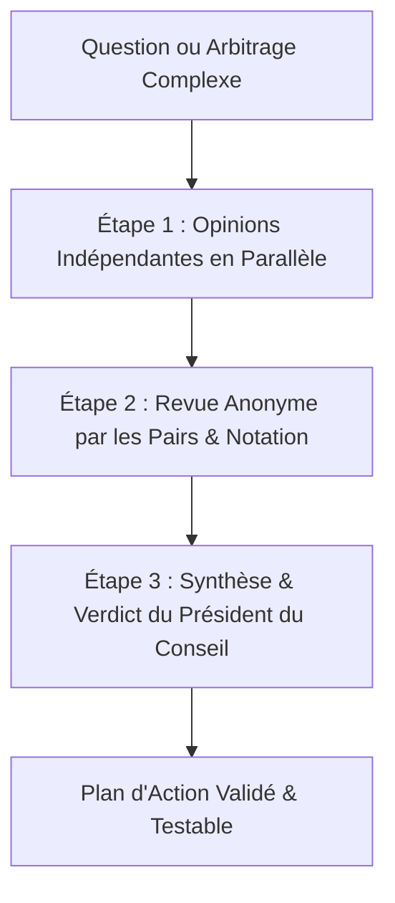

# 🏛️ LLM Council — Protocole de Délibération des Sages de l'IA

Inspiré du projet officiel d'**Andrej Karpathy** (`karpathy/llm-council`), ce skill transforme la prise de décision technique en un processus démocratique, rigoureux et anti-hallucination.

---

## 🎯 Pourquoi utiliser le LLM Council ?
- **Zéro angle mort :** Une seule IA peut halluciner, oublier un cas limite ou privilégier une solution trop complexe.
- **Objectivité totale (Peer Review Anonyme) :** Chaque proposition est notée sans savoir qui l'a formulée, éliminant les biais de complaisance.
- **Arbitrage net (Chairman) :** La délibération aboutit toujours à une décision concrète, immédiatement actionnable par le développeur.

---

## 🔄 Le Protocole en 3 Étapes

### Étape 1 : Premières Opinions en Parallèle (First Opinions)
Sur un problème posé (ex: choix d'architecture BDD, sécurité d'authentification, performance réseau), 3 à 4 perspectives distinctes s'expriment sans se concerter :
1. **Perspective ALPHA — Performance & Scalabilité** : Vitesse d'exécution, requêtes minimales, temps de chargement sur réseau 3G.
2. **Perspective BETA — Sécurité & Robustesse** : Risques OWASP, fuites de données, résistance aux pannes, gestion des transactions.
3. **Perspective GAMMA — Simplicité & Anti-Sur-Ingénierie** : Facilité de maintenance, code lisible, zéro dépendance superflue.
4. **Perspective DELTA — Ergonomie & Expérience Terrain** : Fluidité d'usage, impact client, conversion commerciale.

---

### Étape 2 : Revue Anonyme par les Pairs (Blind Peer Review)
Chaque perspective reçoit les propositions des autres de façon anonymisée (Proposition A, Proposition B, Proposition C) et doit :
- **Identifier les faiblesses cachées** et les risques non mentionnés.
- **Attribuer une note de 1 à 10** sur 3 critères : *Faisabilité*, *Sécurité*, *Simplicité*.
- **Établir son classement objectif**.

Tableau type de notation généré à cette étape :
| Proposition Anonyme | Faisabilité (/10) | Sécurité (/10) | Simplicité (/10) | Note Globale (/30) | Critique Principale |
| :--- | :---: | :---: | :---: | :---: | :--- |
| **Proposition A** | 9 | 7 | 8 | 24 | Très rapide mais manque de gestion des coupures réseau. |
| **Proposition B** | 8 | 10 | 6 | 24 | Extrêmement sûre mais introduit trop de complexité. |
| **Proposition C** | 9 | 9 | 9 | **27** | Le compromis parfait : simple, robuste et facile à tester. |

---

### Étape 3 : Synthèse & Verdict du Président (Chairman Synthesis)
Le **Président du Conseil (The Chairman)** prend la parole pour clôturer le débat :
1. Il synthétise les points d'accord unanimes.
2. Il tranche les points de friction en expliquant pourquoi.
3. Il livre la **Décision Finale Unique**, découpée en étapes claires et testables.

---

## 🚀 Comment Déclencher le Skill ?

Tu peux invoquer ce protocole à tout moment en utilisant l'une des commandes suivantes :
- `CONSEIL : [ton problème ou ton choix technique]`
- `/council [ton problème]`
- Ou simplement : *"Je veux l'avis du Conseil sur ce point..."*

### Exemples d'utilisation dans AKLAM :
- `CONSEIL : Comment stocker les tokens de session admin sans faire planter Next.js sur Vercel ?`
- `CONSEIL : Faut-il mettre les photos des ateliers en CDN externe ou dans le dossier public en WebP ?`
- `CONSEIL : Quel modèle de synchronisation entre Neon PostgreSQL et le panier local useCart.tsx ?`
